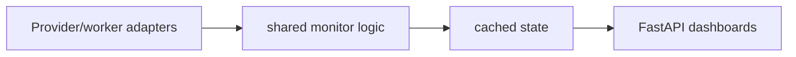

# GPU Operations Monitor

**Worker status, provider observations and operational cost visibility.**

  [](LICENSE)

[Overview](#overview) · [Quickstart](#quickstart) · [Example](#example) · [Validation](#validation) · [Documentation](#documentation)

## Overview

A multi-service dashboard for GPU worker status, provider observations and operational cost tracking.

**Stack:** Python · FastAPI · httpx · Redis · JavaScript/HTML dashboards · Docker Compose

## Observe infrastructure through explicit adapters

| Component | Behavior |
| --- | --- |
| Adapters | Provider/worker integrations feed shared monitoring code. |
| State | Redis and local JSON retain observations used by dashboards. |
| Operations | Cost and worker metadata support inspection of infrastructure state. |

## Processing path



## Quickstart

```console
python -m venv .venv
# Activate .venv, then:
python -m pip install -r dashboard/requirements.txt
python -m compileall -q dashboard monitors
```

The commands above install prerequisites or run the specified offline checks. Live collection, cloud operations, messaging and trading are separate operational steps when present.

## Example

**Inspect the workflow**

Begin with [dashboard/app.py](dashboard/app.py) and the Compose service map. Identify which monitor supplies an observation, where it is cached and how the dashboard reads it. A missing or stale observation should remain distinguishable from a healthy worker. Source compilation does not allocate a cloud machine.

## Configuration and storage

Dependencies are scoped to individual monitor/dashboard directories. [.env.example](.env.example) documents provider keys, Redis, polling intervals and optional automation settings. Review [docker-compose.yml](docker-compose.yml) before selecting services.

## Repository guide

| Location | Responsibility |
| --- | --- |
| [dashboard/app.py](dashboard/app.py) | Dashboard API |
| [dashboard/state_store.py](dashboard/state_store.py) | Dashboard state |
| [monitors](monitors) | Provider-specific monitors |
| [docker-compose.yml](docker-compose.yml) | Service composition |

## Validation

The quickstart lists the declared checks. No passing CI or coverage claim is implied by the technology badges.

## Scope and operational boundaries

Some adapters include provisioning and other operational actions. Dashboard inspection does not imply approval to start the full stack. Provider rates, availability and cost figures require current provider verification.

## Documentation

- The repository guide above links directly to the implementation and configuration files.

## License and attribution

Project-authored source code is licensed under the [MIT License](LICENSE). Third-party components and datasets retain their respective rights and licenses.
